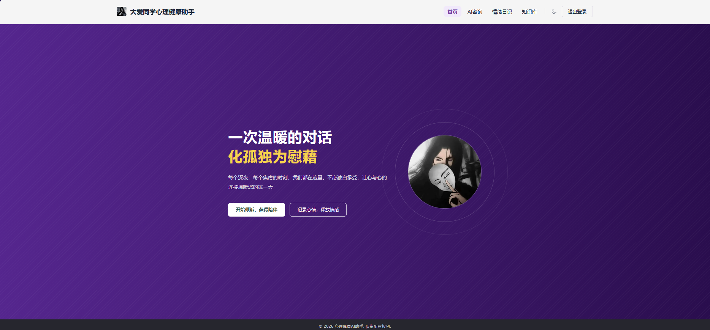
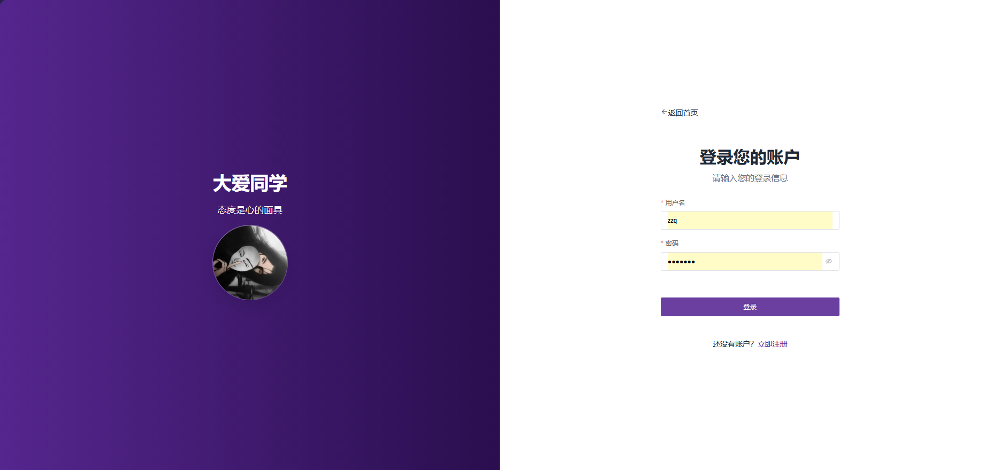
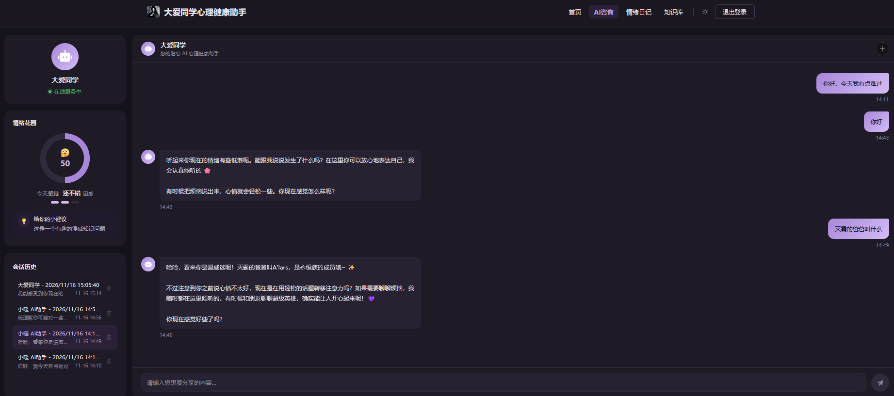
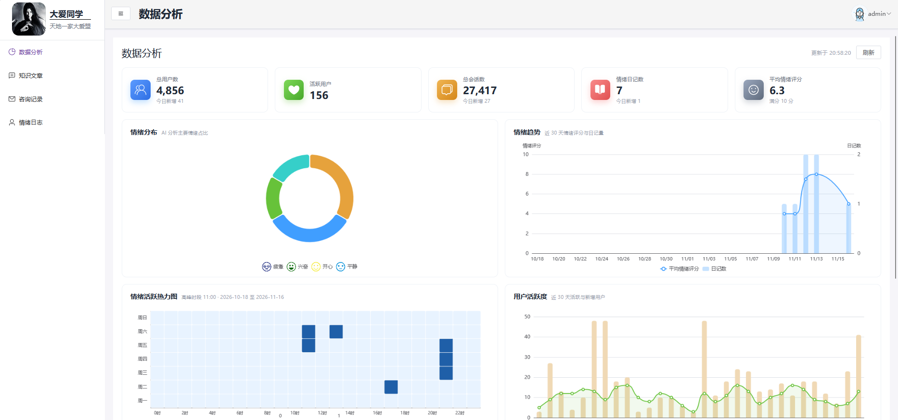

# 心理 AI 助手 · 双端 Web 前端

> 面向心理健康场景的 AI 对话产品前端，一套代码同时承载**用户端**（AI 咨询、情绪日记、知识库）与**管理端**（数据看板、内容管理、咨询与情绪记录）。


<!-- TODO 建议在此放置 2–3 张截图（docs/screenshots/xxx.png），首屏最影响第一印象


-->





---

## ✨ 功能一览

### 用户端

| 模块 | 说明 |
|---|---|
| AI 咨询 | SSE 流式对话，逐字输出、会话历史、新建/切换/删除会话、失败重试、情绪花园实时展示当天情绪 |
| 情绪日记 | 七维情绪记录（心情评分、主要情绪、睡眠、压力、触发因素、感想），牛皮纸质感表单 + 抽屉展开动画 |
| 知识库 | 推荐阅读 Top10 + 全部文章双栏，支持按发布时间/阅读量排序、分页、文章详情、收藏、最近阅读 |
| 账号 | 注册 / 登录 / 退出，按角色自动分流到用户端或管理端 |

### 管理端

| 模块 | 说明 |
|---|---|
| 数据分析 | 5 项核心指标卡片 + 情绪分布环形图 + 情绪趋势双轴图 + 7×24 情绪热力图 + 用户活跃度 + 咨询趋势，30 秒自动刷新 |
| 知识文章 | 新增/编辑（富文本 + 封面上传）、发布/下线、删除，均带二次确认 |
| 咨询记录 | 会话列表、消息气泡弹窗（骨架屏加载 + 逐条入场动画） |
| 情绪日志 | 情绪日记检索、详情（含 AI 情绪分析结果解析）、删除 |

### 通用能力

- **深色模式**：导航栏一键切换，本地持久化，Element Plus 与自定义组件同步换肤
- **响应式**：≤900px 导航折叠为抽屉菜单，卡片网格自适应
- **设计系统**：颜色/圆角/阴影/动效全部走 CSS 变量令牌，一处修改全站生效

---

## 🧠 技术难点与实现思路

> 下面每一项都能在仓库里找到对应代码，建议按"问题 → 方案 → 位置"的顺序阅读。

### 1. SSE 流式对话：不用 axios，手写一套事件解析

**问题**：项目里的 axios 实例在响应拦截器里解包 `data.data`，且要等整个响应体读完才 resolve，拿不到流式能力；同时实例设了 5s 超时，长对话会被掐断。

**方案**：`src/api/user.js` 用原生 `fetch` + `ReadableStream.getReader()` 自建 SSE 客户端：

- `TextDecoder(stream: true)` 处理 UTF-8 多字节字符被网络分包切断的问题；
- 维护缓冲区，按空行 `\n\n` **分帧**，跨包残缺的事件留到下一块继续拼；
- 统一 `\r\n` 换行，兼容不同网关；
- 按 **`event:` 事件名分流**：`message` 取正文、`done` 结束、`error` 抛出后端原话；
- 正文取值**下钻两层**（真实结构是 `data.data.content`），并兼容纯文本分片；
- **首字超时** 15s：超时主动 `reader.cancel()` 并抛出明确错误；
- 对外暴露 `AbortSignal`，切会话 / 新建对话 / 组件卸载时可中断请求。

页面侧（`src/views/front/consultation.vue`）再用 `requestAnimationFrame` 做**渲染节流**：分片先攒在本地变量、每帧刷一次视图，避免每个 token 触发一次响应式更新；失败时在气泡上标记并提供"重试"。

> 这套实现踩过的坑（错误事件被吞、正文取错层级、会话 ID 双格式、分包与 CRLF）都沉淀成了代码里的注释。

### 2. 双端权限与请求层设计

- **路由守卫**（`src/router/index.js`）按 `meta.public / meta.requiresAuth` 与 `userInfo.userType` 三向分流：游客可浏览首页与知识库；登录用户进用户端；仅管理员可进 `/back/*`。首页精确匹配、其余前缀匹配，`/knowledge/:id` 也能正确高亮"知识库"。
- **凭证注入与失效处理**（`src/utils/request.js`）统一在拦截器里完成：注入 `token`、解包业务数据、业务码 `-1` 判定登录失效。
- **"页面级请求不踢人"**：用户端页面的数据请求带 `skipAuthRedirect`，失败时只在页面内提示，不会因为单个接口异常就把用户整体登出；只有真正的会话操作才触发登录页跳转，并携带 `redirect` 参数，登录后回到原页面。

### 3. 数据看板与图表工程化

`src/views/dashboard.vue`：

- ECharts **按需引入**（`echarts/core` + 只用到的 Pie / Line / Bar / Heatmap 与组件），避免打包整个库；
- 5 个图表统一用「`xxxOption()` 工厂 + `setChart` 复用实例」的结构，数据刷新时只换配置不重建 canvas；
- 双 Y 轴把「情绪评分 0–10」与「日记数」分开，避免量级悬殊导致曲线贴底；
- 7×24 热力图用 `visualMap` 做数值到颜色的映射，色阶上限随数据动态计算；
- 空数据时保留图表容器尺寸、用绝对定位的空状态覆盖，避免初始化 0×0 画布；
- 30 秒轮询 + **静默刷新**（不触发整页 loading）+ **连续失败熔断**（3 次后暂停自动刷新并提示，防止错误弹窗刷屏）。

### 4. 设计系统与深色模式

`src/styles/theme.scss` 定义了一套 CSS 变量令牌（品牌色阶、中性色、圆角、阴影、缓动、牛皮纸配色），浅色/深色各自一套值：

- 页面里不再出现硬编码色值，换肤只需改令牌；
- Element Plus 通过覆盖 `--el-color-primary` 系列变量统一主色，暗色模式接入官方 `dark/css-vars.css`；
- 首屏在 `mount` **之前**应用主题避免闪白；切换瞬间临时关闭过渡，防止大面积颜色闪烁；
- 处理了"浅紫底 + 白字"在暗色下对比度不足的问题，新增 `--on-brand` 令牌；
- 尊重系统 `prefers-reduced-motion`，关闭动画。

### 5. 后端数据不一致的兼容层

联调中遇到三类不一致，统一在 `src/utils/article.js` 等归一化函数里处理，页面只消费干净数据：

- **字段命名不统一**：`publishedAt / publishTime`、`tags`（逗号串）与 `tagArray`（数组）；
- **同一实体的不同 ID 形态**：消息接口用数字 `41333`，情绪分析接口要 `session_41333`，内部统一存数字、按接口补前缀；
- **封面是相对路径**：`/files/...` 统一拼上文件服务器前缀。

### 6. 交互细节

- **导航滑块**：测量当前高亮项的 `offsetLeft/offsetWidth`，用 `transform + width` 过渡实现平滑滑动（走合成层，不触发重排）；
- **抽屉展开动画**：卡片用 `clip-path` 从下往上"抽出"，同时由 JS 在动画结束后移除 class —— 即使动画未执行（后台标签页等）也不会把内容永久隐藏；
- **列表与详情**：卡片悬停上浮、封面轻微缩放、骨架屏加载、逐条入场动画。

---

## 🛠 技术栈

| 分类 | 选型 |
|---|---|
| 框架 | Vue 3.5（`<script setup>`）、Vue Router 4、Pinia 3 |
| 构建 | Vite 8、Sass |
| UI | Element Plus 2.13、@element-plus/icons-vue |
| 图表 | ECharts 6（按需引入） |
| 请求 | Axios（封装拦截器）+ 原生 fetch（SSE 流式） |
| 编辑器 | WangEditor 5（管理端富文本） |

---

## 🚀 快速开始

```bash
# 1. 安装依赖
npm install

# 2. 配置后端地址（默认代理到 /api，见 vite.config.js）
#    建议把 proxy target 抽到 .env，避免把测试环境地址写死在仓库里

# 3. 启动
npm run dev        # 开发
npm run build      # 构建
npm run preview    # 预览构建产物
```

**后端依赖**：本项目为纯前端，需配合后端服务运行。登录后按账号 `userType` 分流 —— `2` 进入管理端 `/back/dashboard`，其它进入用户端 `/`。

<details>
<summary>核心接口一览</summary>

| 方法 | 路径 | 用途 |
|---|---|---|
| POST | `/user/login` · `/user/add` · `/user/logout` | 登录 / 注册 / 退出 |
| GET | `/psychological-chat/sessions` | 咨询会话分页 |
| GET | `/psychological-chat/sessions/{id}/messages` | 会话消息 |
| POST | `/psychological-chat/session/start` | 创建会话 |
| POST | `/psychological-chat/stream` | 流式对话（SSE） |
| GET | `/psychological-chat/session/{id}/emotion` | 会话情绪分析 |
| POST | `/emotion-diary` | 创建/更新情绪日记 |
| GET | `/knowledge/article/page` · `/knowledge/article/{id}` | 文章列表 / 详情 |
| GET | `/data-analytics/overview` | 综合数据分析 |

</details>

---

## 📁 目录结构

```
src/
├─ api/                 # 接口层：admin.js（管理端）、user.js（用户端 + SSE）
├─ components/          # 布局与通用组件（前后台布局、导航、富文本、通栏标题、状态页）
├─ router/              # 路由表 + 双端权限守卫
├─ stores/              # Pinia（侧边栏折叠等全局 UI 状态）
├─ styles/theme.scss    # 设计令牌（浅色/深色两套）
├─ utils/               # 请求封装、主题、文章归一化、收藏/历史等
├─ views/               # 管理端页面
│  └─ front/            # 用户端页面（首页、AI 咨询、情绪日记、知识库、文章详情）
└─ config/              # 文件服务器等运行时配置
```

---

## ⚠️ 已知限制

- **文章收藏 / 最近阅读**目前存于 `localStorage`：后端尚未提供收藏接口，`src/utils/favorites.js` 已把状态切换收敛到单一入口，接口就绪后替换内部实现即可；
- **情绪日记**后端只有写入接口，因此"今日情绪"暂存本地，换设备后聊天页的情绪花园会显示"暂无"；
- 未包含单元测试，类型系统依赖 Vue 的运行时校验；
- 列表/详情字段按常见命名做了兼容，与特定后端联调时可能需要按实际响应收窄。

## 🗺 Roadmap

- [ ] 个人中心（资料、我的日记、我的收藏）
- [ ] 知识库关键词搜索与分类筛选
- [ ] 情绪打卡连续天数与周/月趋势
- [ ] 单元测试与 ESLint / Prettier 工程化

---

## 📄 License

[MIT](./LICENSE)

> 若用于二次开发，请注意心理健康类产品的合规要求（隐私政策、危机干预提示、内容审核）。
